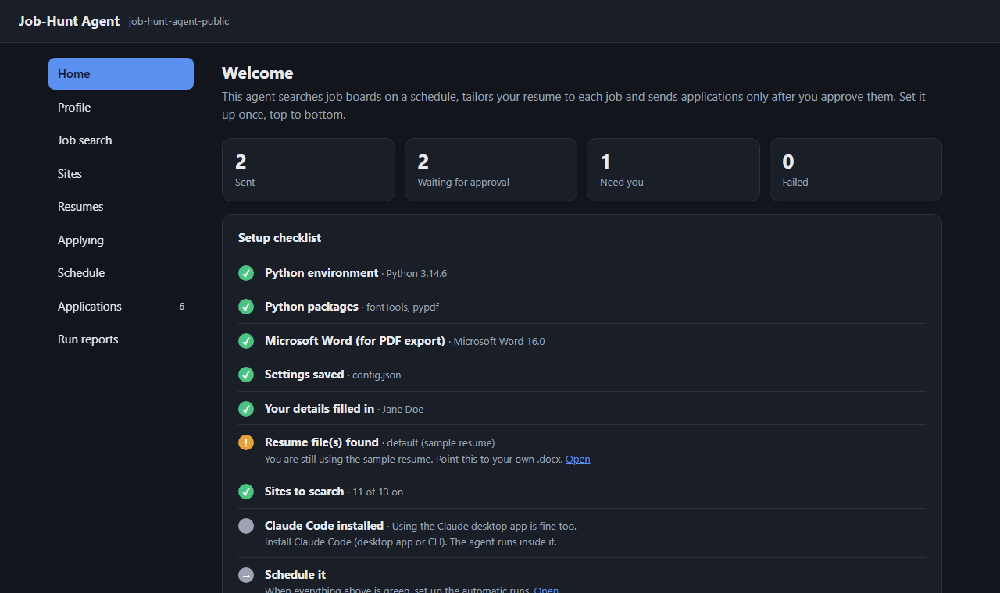
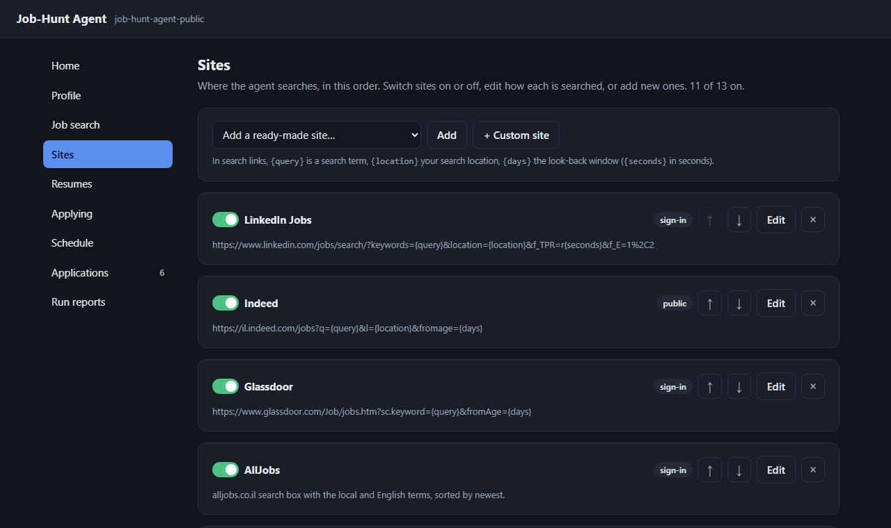
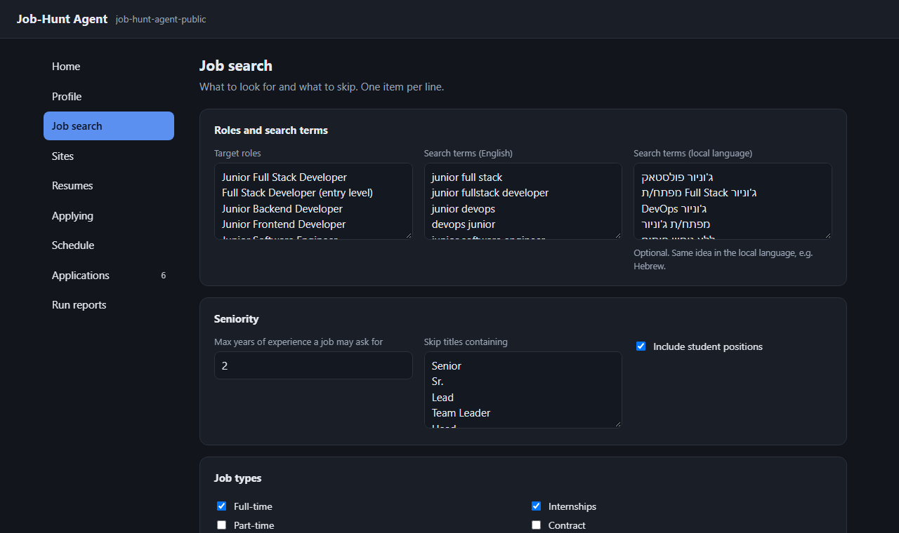
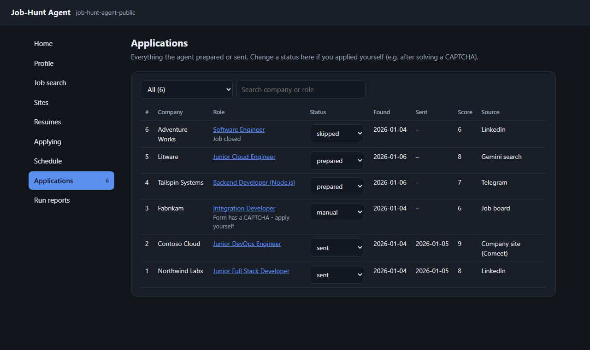
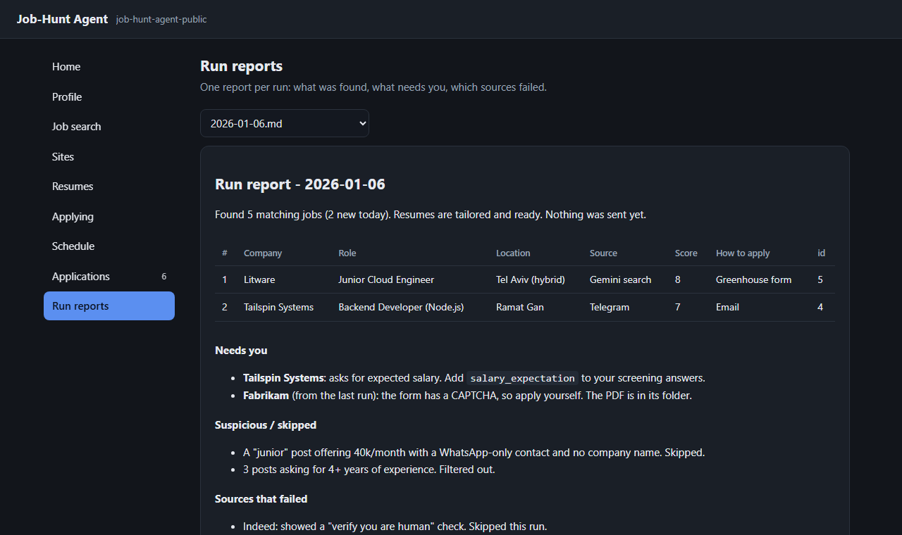
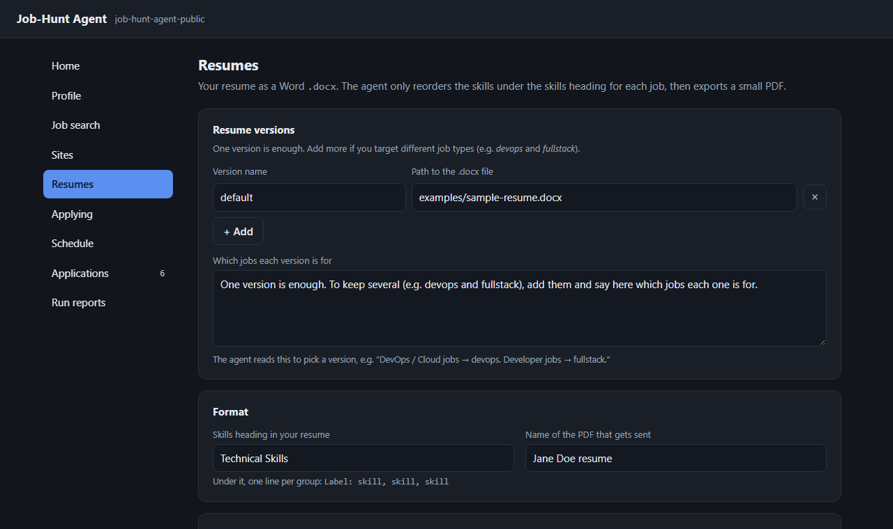

# Job-Hunt Agent

[](https://github.com/DorEydan/job-hunt-agent/actions/workflows/tests.yml)


An AI agent, built on **Claude Code**, that runs a junior developer's job search end to end:
it searches job boards three times a week, filters and scores postings, tailors the resume for each job,
and sends applications **only after you approve them**. A local control panel handles setup and tracking.



## Quick start

1. **Get it:** `git clone https://github.com/DorEydan/job-hunt-agent.git` (or Code → Download ZIP).
2. **Run `start.bat`** (double-click). The first time it creates a Python environment, installs two packages,
   creates `config.json` and opens the control panel in your browser.
3. **Follow the checklist** on the Home page: your details, your resume (`.docx`), search terms.
   It works out of the box with the fictional [sample resume](examples/sample-resume.docx), so you can try
   the resume tools before using your own.
4. **Automate:** the *Automate* tab gives you the exact prompt to paste into Claude Code to run it now and
   to schedule it.

| You need | For |
|----------|-----|
| Windows + Python 3.11+ | The tools and the control panel |
| Microsoft Word | Exporting the tailored resume to PDF (layout stays exactly yours) |
| [Claude Code](https://claude.com/claude-code) (desktop app or CLI) | The agent itself |
| Claude in Chrome extension | Sites that need your sign-in: LinkedIn, job boards, Gmail |

## How it works

```
 Scheduled run (your days and time; default Sun / Tue / Thu 09:00)
        │
        ▼
 Phase A – automatic
   1. Search the sites you switched on (LinkedIn, Indeed, Glassdoor, local boards, company ATS pages, Telegram…)
   2. Filter: role, seniority, job type, location, keywords, companies; score each posting 1–10 for fit
   3. Skip anything already applied to in the last 60 days
   4. Tailor the resume: pick the right base version, reorder skills to match the posting, export a small PDF
   5. Write a run report and wait
        │
        ▼  you reply: "send 1,3,5"
 Phase B – sending
   LinkedIn Easy Apply / ATS forms (Comeet, Greenhouse, Ashby, BambooHR…) / email
   Every application is logged: date, company, role, method
```

| Sites | Job search rules | Applications |
|---|---|---|
|  |  |  |
| **Run reports** | **Resumes** | |
|  |  | |

See a full [sample run report](examples/sample-run-report.md) and a [sample application log](examples/sample-applications.csv).

## Engineering highlights

- **Human in the loop by design.** Phase A is automatic; nothing is sent until you approve specific jobs in the chat.
- **Self-verifying resume edits.** `tailor_resume.py` edits the Word XML directly, only reorders existing skills,
  refuses any skill not already on the resume, and checks that the text of every other paragraph is unchanged
  before writing.
- **PDF size fix.** Word embeds the whole emoji font (4.4 MB PDFs, rejected by many forms). `shrink_pdf.py`
  subsets oversized fonts with fontTools while keeping glyph IDs, links and color icons: **4.4 MB → 0.3 MB**.
- **Prompt-injection aware.** Job posts are treated as untrusted data; instructions inside them are ignored and
  scam patterns (payment, ID numbers, WhatsApp-only contacts) are flagged, not acted on.
- **Duplicate protection.** Fuzzy matching on company + role (token Jaccard, difflib) plus LinkedIn job IDs.
- **Locked-down local server.** The control panel binds to `127.0.0.1`, rejects foreign `Host`/`Origin` and
  cross-site requests (DNS-rebinding and CSRF), uses a strict CSP, and validates every input. Tested in CI.

## Project layout

```
AGENT.md                 the playbook the agent follows on every run
sources.md               search tips and notes the agent learns while running
config.example.json      template settings  →  copied to config.json on first start
start.bat / start.ps1    one-click setup + control panel
ui/                      local control panel (Python standard library + one page, no framework)
tools/
  tailor_resume.py       reorder skills in a .docx, export + shrink the PDF
  tracker.py             application log with the "no re-send within 60 days" rule
  shrink_pdf.py          font subsetting for small PDFs
  docx_to_pdf.ps1        Word export to PDF
examples/                fictional sample resume, run report and application log
tests/                   unit tests (run in GitHub Actions on Windows and Linux)

git-ignored, stays on your computer:
  config.json  applications.csv  applications/  runs/  your resumes
```

## Customize

Everything is in the control panel; under the hood it edits `config.json`. Settings added in newer versions
get their defaults automatically, so an older `config.json` keeps working.

| Tab | What you can change |
|-----|---------------------|
| **Profile** | Contact details used in forms and emails; the language of run reports |
| **Job search** | Target roles; search terms in English and your local language; max years of experience; words that disqualify a title; job types (full-time, part-time, student, internship, contract, freelance); keywords a job must mention or must not mention; companies to never apply to; search location, cities, remote/hybrid; how many days back to look; max jobs per run; minimum match score; re-apply and re-offer windows |
| **Sites** | Switch each site on or off, reorder them (the agent searches in this order), edit how each one is searched and applied to, or add new ones: 17 ready-made sites (LinkedIn, Indeed, Glassdoor, Wellfound, Built In, Welcome to the Jungle, Remote OK, We Work Remotely, Hacker News "Who is hiring", company ATS pages, Gemini search, Telegram, Facebook groups, and Israeli boards) or any custom site. Search links take `{query}`, `{location}`, `{days}` and `{seconds}` |
| **Resumes** | One or more resume versions (e.g. `devops`, `fullstack`) and which jobs each is for; the skills heading; the name of the sent PDF; a test export |
| **Applying** | Which ways of applying are allowed (quick apply, job-board send-CV, company forms, email, social messages); whether to paste the cover note into optional fields; notifications; screening answers; cover notes per language |
| **Schedule** | Days and time (presets: 3× a week, 2× a week, workdays, daily). It generates the exact text to paste into Claude Code to create or update the scheduled task, and warns if the look-back window is shorter than the gap between runs |

Fixed on purpose: nothing is sent without your approval, and the agent never solves CAPTCHAs, creates accounts or
types passwords. New sites the agent discovers are added switched off, for you to review.

## Command line

```
.venv\Scripts\python.exe tools\tailor_resume.py --list
.venv\Scripts\python.exe tools\tailor_resume.py --out out\test --first "Frameworks=React" --line-order "Frameworks"
.venv\Scripts\python.exe tools\tracker.py list --days 60
.venv\Scripts\python.exe -m unittest discover -s tests -v
```

## Rules the agent keeps

No CAPTCHA solving, no account creation, no passwords: those jobs are handed back to you.
A capped number of new jobs per run (default 15), at a human pace on LinkedIn. Details in [AGENT.md](AGENT.md).

## License

[MIT](LICENSE)
